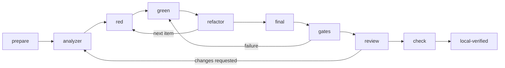

# turbo-12f

> A local software factory that turns a task file into a reviewed,
> test-driven candidate commit, and keeps the evidence for every step.

turbo-12f is an evidence-and-policy layer around AI coding work, built
strictly on [12-Factor Agents](https://github.com/humanlayer/12-factor-agents)
(Dex Horthy, HumanLayer) and the super-board reviewer workflow. It
rebuilds the best of Turbo to run locally. Its home is
[huyle-gradion/turbo-12f](https://github.com/huyle-gradion/turbo-12f),
not the `huyle-gradion/turbo` repo; contact huy.leminh@gradion.com.

The core is a deterministic CLI (`bin/t12`). It never calls a model:
workers are omp sessions started by `adapters/runner.py` (or by an
operator by hand) with the owned prompts in `prompts/`. Each worker
ends its step with a tool call, and the core checks it, runs the tests
itself, records the result as hashed evidence, and decides the next
step. Forges and trackers are reached only through the adapters in
`adapters/`.

> [!NOTE]
> The core and the tests use only the Python standard library, with
> no network, credentials or model calls.

## Features

- **Test-driven by construction.** An analyzer turns the acceptance
  criteria into a test list. Red writes one failing test at a time,
  and the core checks that it fails at the stated assertion. Green
  and refactor work in a blind worktree with no test files, and never
  run tests themselves.
- **Evidence, not declarations.** Every test run, gate and review is
  stored with its argv, exit code, output, SHA-256 and commit, in a
  hash-chained event log that `t12 verify` audits.
- **Bounded autonomy.** Time, operation, cycle, attempt and repair
  budgets per task. A spent budget or a question the worker cannot
  answer pauses the run for a human.
- **Sandboxed verification.** Tests and gates run in a fresh checkout
  under Landlock (Linux) or Docker, with credentials stripped and no
  network.
- **Parallel lanes.** The analyzer can split the work into units that
  own separate files; each runs as its own lane, and the core merges
  them one at a time and reruns every test on the merge.
- **One reviewer for quality and security**, on a model you choose,
  bound to the candidate commit.
- **Delivery adapters** for GitHub, GitLab, Bitbucket and Asana, plus
  intake from GitHub and GitLab issues. The adapter never merges.

## How it works



A refactor step is skipped after a small green. When the analyzer
splits the list into units, each unit runs the red, green and refactor
loop in its own lane, and `t12 tdd-step --unit` merges the lanes before
`final`.

> [!IMPORTANT]
> `local-verified` means the configured evidence chain was observed
> and is internally consistent. It is not acceptance and not
> permission to merge: a human merges.

## Prerequisites

- Python 3 and git (the container image and the tests use Python 3.12)
- omp (oh-my-pi) to run workers through the runner, with a logged-in
  `t12-worker` profile
- Linux with Landlock for the verification sandbox, or Docker

## Quick start

Point the factory at a product repo. The state home holds runs and
evidence, outside the repo:

```sh
bin/t12 init --repo /path/to/product --home /path/to/state-home
bin/t12 prepare --home /path/to/state-home --task examples/task.json
```

The product repo describes its test, lint and gate commands in
`.t12/project.json`; a task file adds the acceptance criteria (see
`examples/task.json`). Then let the runner drive every step with omp
workers:

```sh
omp --profile t12-worker        # once per machine: /login, then leave
python3 adapters/runner.py --home /path/to/state-home \
  --role-model reviewer=anthropic/claude-opus-5-5 --role-thinking reviewer=high
bin/t12 board --home /path/to/state-home
```

The runner stops when every run is `local-verified` or waiting for a
human. Answer a paused run with `t12 resume --answer`, then deliver:

```sh
python3 adapters/github.py create-pr --home /path/to/state-home \
  --task-id demo-1 --out delivery.json
bin/t12 deliver --home /path/to/state-home --task-id demo-1 \
  --adapter github --report delivery.json
```

> [!TIP]
> To have your coding agent run the factory on your repo for you, give
> it [`docs/operator-agent.md`](docs/operator-agent.md).

<details>
<summary>Driving the steps by hand</summary>

```sh
# 1. Point it at a product repo (state lives outside the repo)
bin/t12 init --repo /path/to/product --home /path/to/state-home

# 2. Admit a task (examples/task.json)
bin/t12 prepare --home /path/to/state-home --task examples/task.json

# 3. TDD lane. Ask each role for its step with `t12 status` / `t12 context`,
#    and hand its tool call to `t12 act`; a green or refactor call carries
#    the patch the runner exported from the blind worktree.
bin/t12 context --home /path/to/state-home --task-id demo-1 \
  --role analyzer --phase analyze
bin/t12 act --home /path/to/state-home --task-id demo-1 \
  --role analyzer --session <analyzer-session> --input test-list.json
#    ...then per item: red (red_test_ready), green (green_ready --patch FILE),
#    refactor (refactor_done --patch FILE). When the next step is `tdd-step`:
bin/t12 tdd-step --home /path/to/state-home --task-id demo-1

# 4. Run the gates in order (the existing suite, e2e)
bin/t12 gate --home /path/to/state-home --task-id demo-1

# 5. One review (quality + security), certify, write the manifest
bin/t12 review --home /path/to/state-home --task-id demo-1 --role reviewer \
  --session <reviewer-session> --verdict approve --report review.md
bin/t12 check --home /path/to/state-home --task-id demo-1
bin/t12 manifest --home /path/to/state-home --task-id demo-1

# Or let the runner drive every step with omp workers (see adapters/README.md)
python3 adapters/runner.py --home /path/to/state-home --queue queue
```

</details>

## Documentation

| Document | What it covers |
|---|---|
| [`docs/reference.md`](docs/reference.md) | Every command, the task file and project profile keys, the TDD lane rules, parallel lanes, intake, delivery, containers and the worker cage |
| [`docs/operator-agent.md`](docs/operator-agent.md) | Running the factory on your repo, step by step |
| [`adapters/README.md`](adapters/README.md) | The runner, omp workers, pinned skills, and the delivery and intake adapters |
| [`DESIGN.md`](DESIGN.md) | Architecture, the factor-by-factor map, and the reasons behind each phase |
| [`CONTEXT.md`](CONTEXT.md) | Vocabulary and truth boundaries: what the factory does not claim |
| [`docs/generic-factory.md`](docs/generic-factory.md) | Project profiles, roles and skills across many projects |

## Tests

```sh
python3 -m unittest discover -s tests -v
bash scripts/smoke.sh
T12=bin/t12-container bash scripts/smoke.sh   # the same smoke, in a container
```

All three run against disposable repos only. The docker adapter tests
run against a fake `docker` stub, and also against the real daemon
when Docker answers and the `python:3.12` image is present locally.
